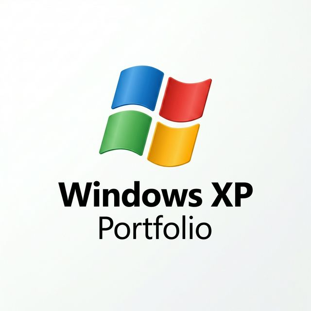

<p align="center">
  
</p>

# 🖥️ Elite OS Simulator (Windows XP)

> **"A high-fidelity, event-driven system simulation engine, reimagined for the modern web."**

This is not just a UI portfolio; it is a **production-grade OS simulator** built with React + TypeScript. It features a deterministic kernel, drift-aware scheduling, a robust Virtual File System (VFS) with file locking, and real-time observability.

---

## 🛠️ Performance & Engineering (Elite Tier)

This project demonstrates senior-level systems engineering through several key subsystems:

### ⚙️ Deterministic Kernel
- **Event-Driven Architecture**: Every system action is a structured event processed through a strict **Validate → Execute → Log** pipeline.
- **Atomic Transitions**: Ensures system state integrity across all asynchronous operations.
- **Hysteresis-Based Backpressure**: Implements kernel-level resource guarding (blocks at 90% CPU, unblocks at 75%) to maintain UI responsiveness under heavy simulation loads.

### ⏱️ Drift-Aware Scheduler
- **Correction Logic**: Uses recursive `setTimeout` with `Date.now()` delta tracking to correct for browser-induced timer drift, maintaining < 50ms accuracy.
- **Deterministic Failure**: Simulates system crashes (`PROC_CRASH`) based on memory pressure and tick-periodicity, including a 20-tick recovery cooldown.

### 📂 Advanced Virtual File System (VFS)
- **Locking Write Lifecycle**: Implements `FS_LOCK` / `FS_UNLOCK` to prevent concurrent write collisions (race conditions).
- **Metadata Tracking**: Every node tracks `createdAt` and `updatedAt` timestamps.
- **Strict Normalization**: Industrial-grade path resolution and boundary enforcement.

### 📊 Observability & Replay
- **Log Correlation**: Every event is traceable via `parentEventId`, allowing for deep auditing of system flows (e.g., tracing a process spawn to its respective file locks).
- **State Snapshots**: Native support for exporting and importing the entire system state as JSON, with strict version enforcement.
- **History Replay**: Bounded 500-event history for debugging and simulating past states in an isolated engine.

---

## ✨ Integrated Applications

- **💻 cmd.exe**: A functional terminal with low-level commands (`ls`, `ps`, `kill`, `priority`, `crash`, `export`).
- **📝 Notepad.exe**: Fully integrated with the VFS locking system; opens in read-only mode if a file is already locked.
- **📈 System Monitor**: Real-time visualization of CPU/Memory jitter and backpressure status.
- **🔎 Event Viewer**: High-fidelity log auditing with fuzzy search and level filtering.

---

## 🚀 Local Deployment

1. **Clone & Enter**:
   ```bash
   git clone https://github.com/Arsh-pixel-cmd/Windows-XP-Portfolio
   cd "Windows XP Portfolio"
   ```

2. **Install & Run**:
   ```bash
   npm install && npm run dev
   ```

Access the simulator at `http://localhost:5173/`.

---

## 🏗️ Tech Stack

- **React 19** + **Vite**: Modern foundation for the simulator.
- **Tailwind CSS 4**: Pixel-perfect Windows XP styling with utility-first efficiency.
- **Lucide Icons**: High-fidelity modern iconography.
- **TypeScript**: Strict typing for all kernel events and state transitions.

---

<p align="center">
  <i>Engineered by Arsh Mishra // Systems Architect</i>
</p>
